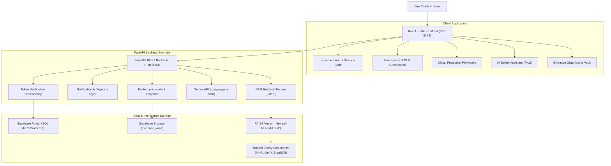

# SafeSignal — An AI-Powered Unified Women's Safety Platform

> **SafeSignal** unites physical emergency response and cyber threat defense into a single, cohesive, modern platform. It combines one-tap SOS workflows, trusted contact dispatch, journey check-ins, guided response playbooks for 8 digital threat categories, encrypted evidence organization, and a Retrieval-Augmented Generation (RAG) conversational assistant grounded strictly in verified Indian emergency and cybercrime resources.

---

## 1. System Architecture



---

## 2. Technology Stack

| Layer | Technologies |
| :--- | :--- |
| **Frontend** | React 18, Vite, JavaScript, React Router v6, Lucide React, CSS Variables Design System |
| **Backend** | Python 3.12, FastAPI, Uvicorn, Pydantic v2, HTTPX, python-dotenv |
| **Database & Auth** | Supabase PostgreSQL, Supabase Auth, Row Level Security (RLS) on all user tables |
| **Storage** | Supabase Storage private bucket (`evidence_vault`) |
| **AI & RAG** | Official Google GenAI SDK (`google-genai`), Sentence Transformers (`all-MiniLM-L6-v2`), FAISS Vector Index (`faiss-cpu`) |
| **Testing** | Python Unittest / Pytest for backend, Node.js syntax & component verification for frontend |

---

## 3. Key Modules & Differentiators

### A. Physical Safety Module
- **Emergency SOS Workflow**: High-visibility SOS button with a 3-second safeguard countdown to abort accidental activations.
- **Transparent Location Sharing**: Permission-based browser GPS coordinates (`lat`, `lng`, accuracy). SafeSignal never runs silent background tracking.
- **Auditable Alert Statuses**: Accurately tracks statuses: `Created`, `Pending`, `Sent`, `Delivered`, `Acknowledged`, `Cancelled`.
- **Truthful Demo Mode**: Clearly labeled `SOS Demo Mode` when a live commercial SMS/call carrier (e.g. Twilio) is not configured, preventing false rescue assumptions.
- **Direct 112 Dial**: One-touch dialer for India's Pan-India Emergency Response Support System (`tel:112`).
- **Journey Safety & Check-ins**: Scheduled destination arrival monitoring with custom check-in reminders (every 10, 15, or 30 min) and overdue escalation.

### B. Digital Protection Centre
Interactive guided response playbooks with step-by-step checklists, account security actions, evidence preservation rules, official recovery links, and statutory Indian law references across **8 categories**:
1. **Hacked or Compromised Social Accounts** (Instagram Hacked portal, session revocation, 2FA hardening).
2. **Cyberbullying & Online Harassment** (Screenshot standards, restrictive muting, IPC 354D).
3. **Impersonation & Fake Profiles** (Platform ID verification forms, IT Act Section 66D).
4. **Deepfakes & Image Morphing** (StopNCII.org cryptographic hash prevention, 24-hr takedown under IT Rules 2021).
5. **Threats, Sextortion & Blackmail** (Cease-communication rules, 1930 financial cyber helpline).
6. **Privacy Breaches & Unwanted Tracking** (Session audits, stalkerware checks).
7. **Suspicious Account Activity & Phishing** (Phishing header analysis, credential rotation).
8. **Misuse of Personal Images** (Non-consensual image takedowns, Section 67A IT Act).

### C. AI Safety Assistant Grounded with RAG
- Powered by the official `google-genai` Python SDK (`from google import genai`).
- Embeddings generated via `sentence-transformers/all-MiniLM-L6-v2` and searched via local `FAISS` index.
- Grounded in official documentation from:
  - Ministry of Home Affairs (ERSS 112 & National Cybercrime Reporting Portal `cybercrime.gov.in`).
  - Ministry of Women and Child Development (181 Women Helpline & Sakhi One Stop Centres).
  - Indian IT Act, 2000 and Indian Penal Code provisions.
  - Official Meta, Google, and WhatsApp account recovery documentation.
  - StopNCII.org cryptographic non-consensual image prevention.
- Clickable verified source badges accompanying answers.
- **Emergency Keyword Priority**: Immediately detects physical distress (e.g., *"someone is following me"*) and elevates Emergency 112 before RAG retrieval.
- **Resilient Fallback Mode**: If `GEMINI_API_KEY` is not configured, the assistant utilizes a local grounded template generator using retrieved sources so hackathon demos remain fully functional.

### D. Evidence Organizer & Vault
- Private record management with categorized search and filtering.
- Logs incident title, category, timestamps, suspect handles, URLs, and evidence notes.
- **Export Incident Summary**: Generates a formal, printable plain-text incident summary structured for submission to local police stations or `cybercrime.gov.in` under Section 65B of the Indian Evidence Act.

### E. Trusted Help Directory
- Pan-India emergency contact directory: **112** (ERSS), **181** (Women Helpline), **1930** (Cyber Fraud), NCW Helpline (7827170170), and iCALL Psychosocial Helpline (9152987821).

---

## 4. Windows Setup & Running Instructions

Open PowerShell on Windows and navigate to the project directory:

```powershell
cd C:\Users\HP\.gemini\antigravity\scratch\SafeSignal
```

### Terminal 1: Backend Setup & Startup

1. **Navigate to the backend folder**:
   ```powershell
   cd backend
   ```

2. **Create and activate a Python virtual environment**:
   ```powershell
   python -m venv .venv
   .\.venv\Scripts\Activate.ps1
   ```
   *(Note: If PowerShell execution policy blocks activation, run `Set-ExecutionPolicy -Scope Process -ExecutionPolicy Bypass` once).*

3. **Install dependencies**:
   ```powershell
   pip install -r requirements.txt
   ```

4. **Configure Backend Environment**:
   Copy the example environment file and configure your API keys:
   ```powershell
   Copy-Item .env.example .env
   ```
   Edit `.env` with your preferred editor:
   - `GEMINI_API_KEY`: Your Gemini API key from Google AI Studio.
   - `GEMINI_MODEL`: `gemini-2.5-flash` (or your available model).
   - `SUPABASE_URL` and `SUPABASE_ANON_KEY`: Your Supabase project keys.

5. **Run RAG Document Ingestion**:
   ```powershell
   python rag/ingest.py
   ```
   *(This builds the 37-chunk FAISS vector index from `rag/documents/`).*

6. **Start the FastAPI Backend**:
   ```powershell
   uvicorn app.main:app --reload --host 127.0.0.1 --port 8000
   ```
   - API will be accessible at: `http://localhost:8000`
   - Interactive Swagger API Docs at: `http://localhost:8000/docs`

---

### Terminal 2: Frontend Setup & Startup

1. **Open a new PowerShell terminal and navigate to the frontend folder**:
   ```powershell
   cd C:\Users\HP\.gemini\antigravity\scratch\SafeSignal\frontend
   ```

2. **Configure Frontend Environment**:
   ```powershell
   Copy-Item .env.example .env.local
   ```

3. **Install Node.js dependencies**:
   ```powershell
   npm.cmd install
   ```

4. **Start the Vite development server**:
   ```powershell
   npm.cmd run dev
   ```
   - Open your browser at: `http://localhost:5173`

---

## 5. Supabase Database & Security Setup

1. Create a free project at [supabase.com](https://supabase.com).
2. Open the **SQL Editor** in your Supabase dashboard.
3. Run `supabase/migrations/001_initial_schema.sql` to generate:
   - `profiles`, `trusted_contacts`, `safety_incidents`, `journey_checkins`, `evidence_records`, `notification_events`.
4. Run `supabase/migrations/002_rls_policies.sql` to enable **Row Level Security (RLS)** and restrict all data operations to `auth.uid() = user_id`.
5. Under **Storage**, ensure the private bucket `evidence_vault` is present.

---

## 6. Running Tests

### Backend Unit Tests
```powershell
cd backend
python tests/run_tests.py
# Or with pytest:
pytest tests -v
```

### Frontend Syntax & Component Integrity Checks
```powershell
cd frontend
node tests/validate_syntax.cjs
```

---

## 7. Hackathon End-to-End Demonstration Flow

To demonstrate SafeSignal to hackathon judges in 3–5 minutes:

1. **Landing Page**:
   - Open `http://localhost:5173`.
   - Point out the top emergency helpline banner (112, 181, 1930) and the two safety pillars: Physical & Digital.
2. **Instant Demo Login**:
   - Click **"Launch Live Demo Mode"** on the hero banner.
   - Shows instant access as verified user *Priya Sharma* without waiting for email verification.
3. **Physical Safety & SOS**:
   - Click the prominent **ACTIVATE SOS** button.
   - Observe the 3-second countdown safeguard.
   - Watch the active incident banner appear with coordinates and simulated notification dispatches to trusted contacts *Aarav Sharma* and *Ananya Verma*.
   - Click **Cancel SOS / False Alarm** to demonstrate graceful, safe cancellation.
4. **Digital Protection Centre**:
   - Navigate to **Digital Protection** in the sidebar.
   - Select **"Deepfakes & Image Morphing"** or **"Hacked Social Media Account"**.
   - Review the step-by-step checklist, StopNCII.org integration guidance, and click **"Log in Evidence Vault"** to pre-fill an incident.
5. **AI Safety Assistant (RAG Grounding)**:
   - Navigate to **AI Safety Assistant**.
   - Click suggested chip: *"Someone created a fake profile using my photos. What should I do?"*
   - Show how the AI response delivers verified steps and displays clickable source citations linking directly to official documentation.
   - Type *"Help me someone is following me right now"* to demonstrate the immediate physical threat emergency override.
6. **Evidence Organizer**:
   - Navigate to **Evidence Organizer**.
   - Click **"Export Summary"** on any record to instantly download a formal, timestamped legal summary ready for submission to `cybercrime.gov.in`.

---

## 8. Responsible AI & Safety Disclaimers

- **Never a Substitute for 112**: SafeSignal assists in crisis response, but users in active physical danger are always urged to call emergency services immediately.
- **Truthful Status Reporting**: SafeSignal never claims emergency services have been dispatched unless confirmed by an integrated authority API.
- **Section 65B Compliance**: Incident records generated in the Evidence Vault organize digital data for reporting; formal judicial admissibility in India requires the appropriate Section 65B certificate.
